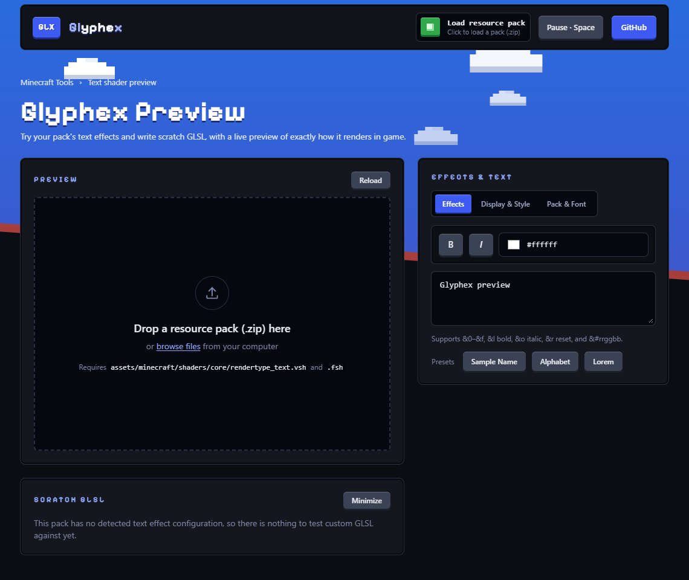

# Glyphex - "preview Minecraft text shaders in your browser"

> A simple, pretty browser tool that lets you load a resource pack, try its text effects and write scratch GLSL, with a live preview of how it renders in game.

[](LICENSE)
[](#privacy)
[](https://ko-fi.com/abhixd)



## Why

Testing a `rendertype_text` shader normally means editing files, reloading the resource pack and walking into a world, over and over. Glyphex gives you the same text rendering in a browser tab, so a change takes seconds instead of a reload cycle.

## Features

- **Load a pack by dropping in its `.zip`.** Glyphex reads the pack's `rendertype_text` vertex and fragment shaders, resolves their `#moj_import` includes and compiles them with WebGL2.
- **Effect browser.** It finds every `TEXT_EFFECT(r, g, b)` effect in the pack. Pick one from a dropdown, or show all of them side by side.
- **Scratch GLSL.** Write effect code and optional helper functions, run them against your pack, and get compile errors with the file and line. Choose whether your code runs in the vertex shader, the fragment shader, or both.
- **Faithful text.** Legacy `&` color codes, `&#rrggbb` hex colors, bold, italic, GUI scale, animation speed, pause and single-step.
- **Font support.** A bundled fallback pixel font, or import your own font atlas (`.png`, or a client `.jar`).
- **Display options.** Checker, solid or custom backgrounds, or your own image with adjustable dimming. A color-box mode for checking effect colors.
- **Pack info at a glance.** Pack icon, name and `pack_format`, plus a version picker for packs with overlays.

## Getting started

You need [Node.js](https://nodejs.org) 22 or newer.

```bash
git clone https://github.com/abhixdd/glyphex.git
cd glyphex
npm install
npm run dev
```

Open the address Vite prints (usually http://localhost:5173), then drop a resource pack onto the preview area.

Your pack needs at least:

```
assets/minecraft/shaders/core/rendertype_text.vsh
assets/minecraft/shaders/core/rendertype_text.fsh
```

Effects appear in the **Effects** tab when the pack defines them with the `TEXT_EFFECT(r, g, b) { ... }` pattern.

## Writing scratch effects

The **Scratch GLSL** panel adds a temporary effect to your loaded pack without touching its files.

| Field | What it does |
| --- | --- |
| **Trigger hex** | The text color that activates your effect. It must not clash with an existing effect. **New** picks a free one. |
| **Effect code** | The body that runs inside `TEXT_EFFECT(...) { ... }`. Call your pack's own functions, or write plain GLSL. |
| **Helper functions** | Optional GLSL placed before the `TEXT_EFFECT` definition, for functions your effect code calls. |
| **Runs in** | **Auto** picks the vertex or fragment shader from what your code uses. Or force **Vertex**, **Fragment** or **Both**. |

Press **Load example** for a complete working effect, then **Run preview**. Your scratch effect is selected automatically, and **Use pack shaders** switches back to the pack as it is.

For example, effect code that bobs the text and recolors it in the vertex shader:

```glsl
float t = GameTime * 24000.0;
gl_Position.y += ProjMat[1][1] * 1.5 * sin(Position.x * 0.45 + t * 0.3);
vertexColor.rgb = vec3(1.0, 0.45, 0.1);
```

Which names you can use (`Position`, `vertexColor`, `GameTime`, and so on) depends on the pack's own shaders.

## How it works

1. [`fflate`](https://github.com/101arrowz/fflate) unzips the pack in the browser and keeps the shader sources.
2. `src/lib/preprocessor.js` expands `#moj_import` includes, using small built-in versions of the vanilla includes where the pack relies on them, and adapts the GLSL for WebGL2.
3. Each effect color becomes its own small shader variant, so only the effects actually on screen are compiled.
4. `src/lib/renderer.js` lays out the text on the font atlas and draws it with the pack's own vertex and fragment shaders.
5. Scratch code is spliced into the pack's effect block, and into the shader stage it belongs to, before compiling.

## Privacy

Everything runs in your browser. Packs, fonts and images are read locally and never uploaded. The most recent pack and font are kept in your browser's own storage so they are still there after a refresh. **Remove pack** and **Reset to bundled font** clear them.

## Browser support

Glyphex needs a current browser with WebGL2, with hardware acceleration turned on. It is developed and tested in Chrome.

## Limitations

- It previews the **text** shader (`rendertype_text`) only.
- Packs that structure their effects very differently from `TEXT_EFFECT(r, g, b) { ... }` may not show an effect list, though the preview still renders.
- It matches the game's text pipeline closely, but it is not the game. Do a final check in Minecraft.

## Scripts

| Command | What it does |
| --- | --- |
| `npm run dev` | Start the development server |
| `npm run build` | Production build into `dist/` |
| `npm run preview` | Serve the production build locally |
| `npm run lint` | Run oxlint |

## Support

Glyphex is free. If it saves you time, you can [buy me a coffee on Ko-fi](https://ko-fi.com/abhixd). Starring the repo and sharing it helps too.

## Contributing

Bug reports, ideas and pull requests are welcome. Read [CONTRIBUTING.md](CONTRIBUTING.md) first, and please follow the [Code of Conduct](CODE_OF_CONDUCT.md). For security issues, see [SECURITY.md](SECURITY.md).

## License

Glyphex is free and open source software under the [GNU Affero General Public License v3.0](LICENSE) (AGPL-3.0).

In short: you can use, study, change and share it. If you distribute a modified version, **or run one as a network service such as a website**, you must make its complete source code available to its users under the same license.

Copyright (c) 2026 ABHI.

## Credits and notices

- Glyphex is an unofficial fan tool. It is not affiliated with Mojang or Microsoft. Minecraft is a trademark of Mojang AB.
- Pixelify Sans is used under the SIL Open Font License 1.1 (`public/fonts/OFL.txt`).
- Built with [React](https://react.dev), [Vite](https://vite.dev), [Tailwind CSS](https://tailwindcss.com) and [fflate](https://github.com/101arrowz/fflate), each under its own license.

Made by [ABHI](https://github.com/abhixdd).
